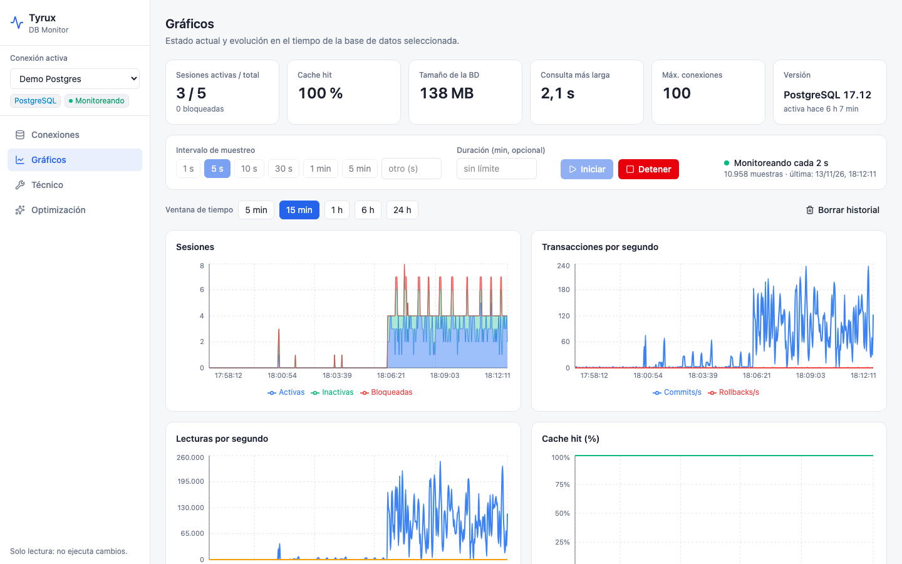
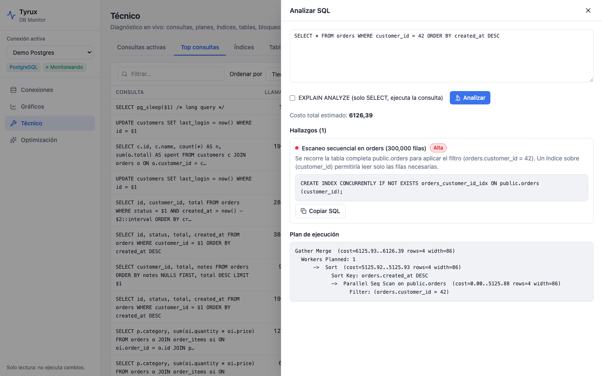
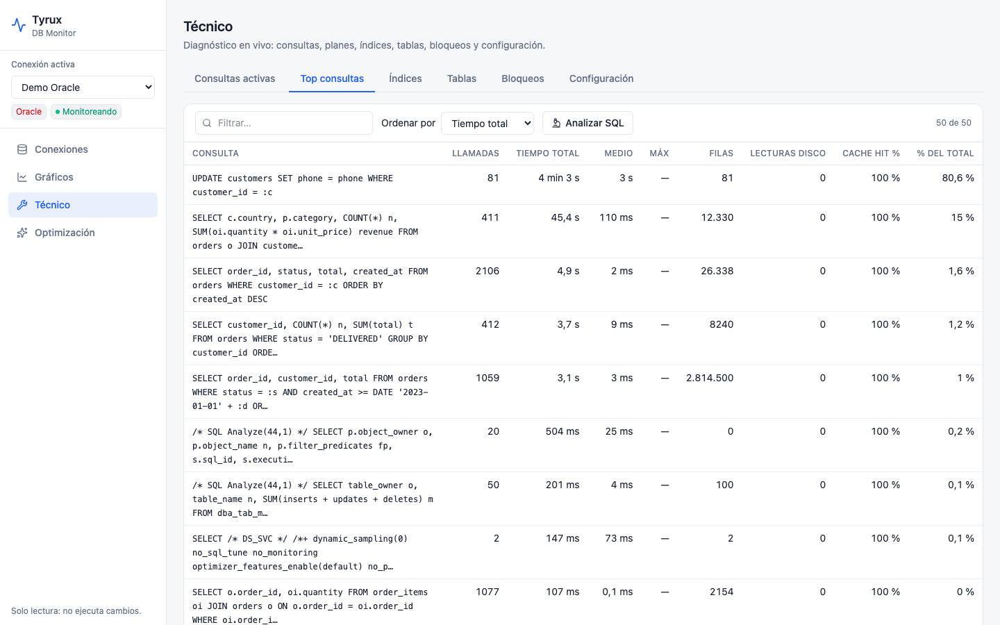
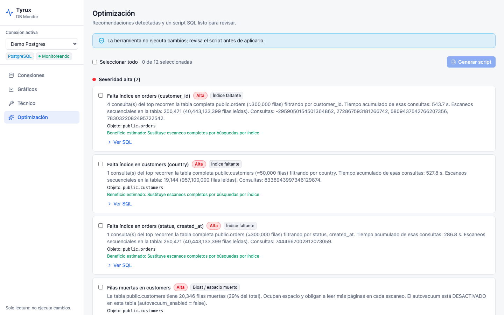
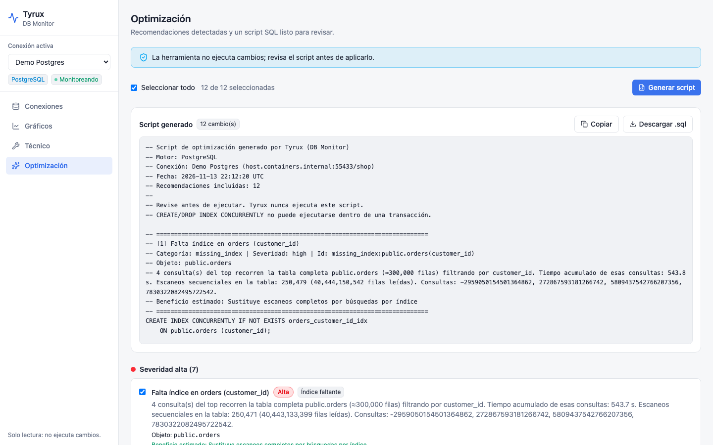
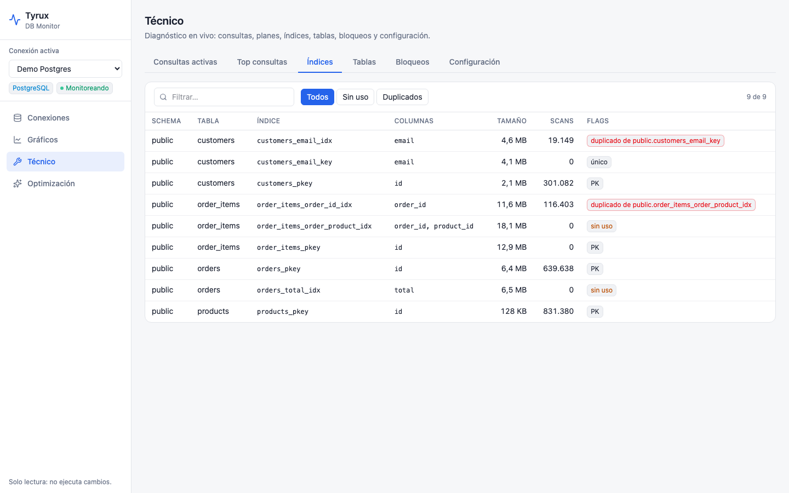
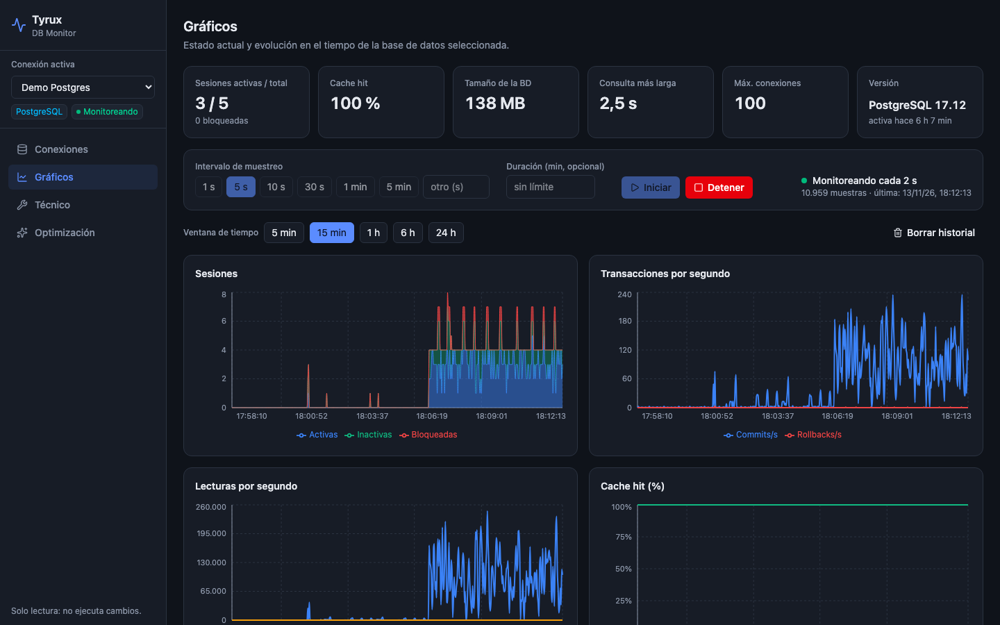

# Tyrux

**DB Monitor** — herramienta web para diagnosticar y monitorear bases de datos **PostgreSQL** y **Oracle**:
qué consultas tardan más y por qué, uso de índices, bloqueos, estado general, gráficos en el tiempo
y generación de SQL de optimización (crear/eliminar índices, estadísticas, VACUUM…).



> La herramienta es de **solo lectura**: nunca ejecuta cambios en tu base de datos. Solo genera el
> script SQL para que lo revises y lo apliques tú.

## Arranque rápido (Docker)

```bash
docker compose up -d --build
```

Abre http://localhost:8080, ve a **Conexiones → Agregar conexión**, prueba y guarda.

Variables útiles (en el entorno o en un `.env` junto al compose):

| Variable | Defecto | Uso |
|---|---|---|
| `DBMON_PORT` | `8080` | Puerto del host para la UI |
| `DBMON_SECRET_KEY` | (autogenerada en el volumen) | Clave Fernet para cifrar contraseñas guardadas |
| `DBMON_RETENTION_HOURS` | `24` | Horas de historial de métricas |
| `DBMON_ORACLE_MODE` | `auto` | Modo de python-oracledb: `auto` (thick si hay Oracle Instant Client, incluido en la imagen), `thick` o `thin` |
| `DEMO_PG_PORT` / `DEMO_ORA_PORT` | `55432` / `1521` | Puertos de las bases demo |

Si el puerto 8080 está ocupado: `DBMON_PORT=8099 docker compose up -d`.

La herramienta guarda sus datos (conexiones, historial) en **SQLite** dentro del volumen `dbmon-data`.

> **Desde el contenedor, `localhost` es el propio contenedor.** Para una base en tu máquina usa
> `host.docker.internal` (Docker Desktop) o `host.containers.internal` (Podman).

### Bases de datos demo (opcional)

```bash
docker compose --profile demo-postgres up -d          # Postgres 17 con datos y problemas sembrados
docker compose --profile demo-oracle up -d            # Oracle 23ai Free (necesita ~2–3 GB de RAM libres)
docker compose --profile workload up -d               # ambas demos + generador de consultas lentas
```

Conexiones de ejemplo dentro de la red de compose:

- Postgres: host `demo-postgres`, puerto `5432`, base `shop`, usuario/clave `dbmon`/`dbmon`
- Oracle: host `demo-oracle`, puerto `1521`, service name `FREEPDB1`, usuario/clave `shop`/`shop`

## Qué incluye

- **Gráficos**: KPIs (sesiones, cache hit, tamaño, consulta más larga) y monitoreo continuo con
  intervalo de **1 s a 60 min** (presets o personalizado), duración opcional y ventanas de 5 min a 24 h:
  sesiones, transacciones/s, lecturas lógicas y físicas/s, cache hit, top consultas del periodo.
- **Técnico**: consultas activas, top consultas (por tiempo total, medio, llamadas o I/O) con
  **plan de ejecución y hallazgos** («por qué tarda»), índices (sin uso / duplicados), tablas,
  bloqueos y parámetros de configuración.
- **Optimización**: recomendaciones por severidad (índices faltantes, sin uso, duplicados,
  estadísticas obsoletas, bloat, configuración) → script SQL para copiar o descargar.

## Capturas

| Plan de ejecución y «por qué tarda» | Top consultas (Oracle) |
|---|---|
|  |  |
| **Recomendaciones de optimización** | **Script SQL generado** |
|  |  |
| **Índices sin uso y duplicados** | **Tema oscuro** |
|  |  |

📖 Documentación completa en la **[Wiki](https://github.com/franmen05/tyrux/wiki)**.

## Permisos necesarios del usuario de conexión

**PostgreSQL**

```sql
GRANT pg_monitor TO mi_usuario;
-- Para "top consultas" se necesita pg_stat_statements:
--   postgresql.conf: shared_preload_libraries = 'pg_stat_statements'  (requiere reinicio)
CREATE EXTENSION IF NOT EXISTS pg_stat_statements;
```

**Oracle** (12.2+; no usa AWR/ASH, así que no requiere Diagnostics Pack)

```sql
GRANT CREATE SESSION, SELECT_CATALOG_ROLE TO mi_usuario;
```

## Desarrollo local

```bash
# Backend (Python 3.12, uv)
cd backend && uv sync && uv run uvicorn app.main:app --reload --port 8080
uv run pytest -q                       # unitarias + integración (las de integración se saltan sin demo)

# Frontend (Node 22+)
cd frontend && npm install && npm run dev      # http://localhost:5173, proxy /api → :8080
DBMON_API=http://localhost:8099 npm run dev    # si el backend corre en otro puerto

# Pruebas de UI (Playwright)
cd e2e && npm install && npx playwright install chromium && npm test
```

Estructura: `backend/` (FastAPI, colectores en `app/collectors/`), `frontend/` (React + Vite),
`docker/` (bases demo y generadores de carga), `e2e/` (Playwright), diseño en
`docs/superpowers/specs/`.

## Licencia

[MIT](LICENSE) © 2026 franmen05
