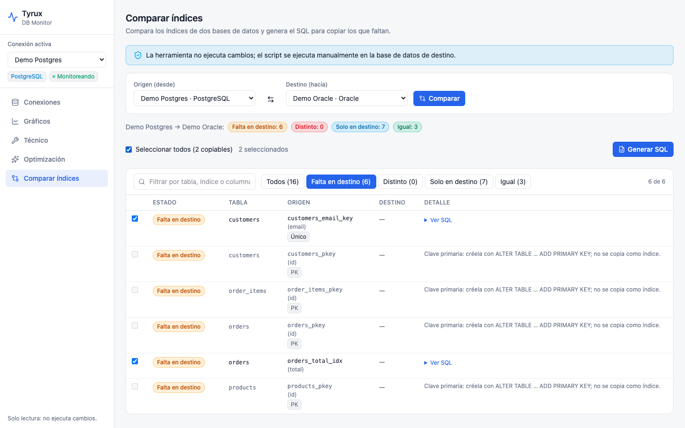
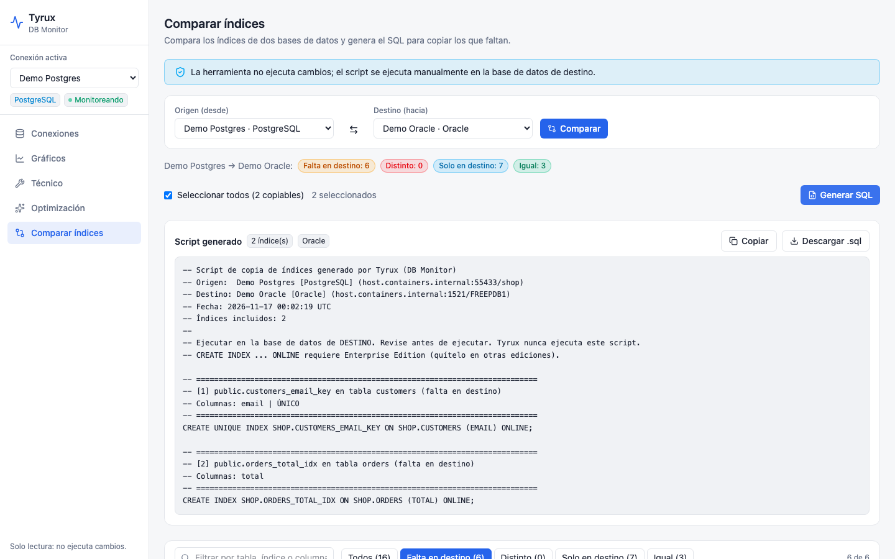

# Comparar índices

La sección **Comparar índices** compara los índices de dos conexiones guardadas (por ejemplo producción y QA)
y genera el SQL para crear en la base de datos de **destino** los índices que elijas de la de **origen**.
Como el resto de Tyrux, es de solo lectura: el script se copia o descarga y lo ejecutas tú.

## Uso

1. Elige **Origen (desde)** y **Destino (hacia)**; el botón ⇆ los intercambia. Deben ser conexiones distintas
   y pueden ser de motores diferentes (PostgreSQL ↔ Oracle).
2. Pulsa **Comparar**.
3. Filtra por estado y marca los índices que quieras copiar (o **Seleccionar todos**).
4. Pulsa **Generar SQL** y **copia** o **descarga** el `.sql` (`copiar-indices-<motor>.sql`).

## Estados

| Estado | Significado | ¿Copiable? |
|---|---|---|
| Falta en destino | Existe en origen y no hay ningún índice equivalente en destino | Sí |
| Distinto | Hay un índice con el mismo nombre en destino pero con otras columnas o unicidad | Sí (con `DROP` comentado) |
| Solo en destino | Existe en destino y no en origen | No |
| Igual | Misma tabla, mismas columnas (en orden) y misma unicidad; el nombre puede diferir | No |

La comparación **no distingue mayúsculas** e **ignora el esquema/owner**, porque suele cambiar entre entornos.
Primero se empareja por tabla + columnas + unicidad y, si no hay coincidencia, por nombre del índice.

No se copian:
- índices de **clave primaria** (créalos con `ALTER TABLE … ADD PRIMARY KEY`);
- índices de tablas que **no existen** en el destino;
- entre motores distintos, índices que las columnas no describen: **expresiones**, **parciales** (`WHERE`),
  `INCLUDE` o métodos que no son B-tree (GIN, GiST…). Entre bases del mismo motor se reutiliza la definición
  original adaptando el esquema y el nombre. Un índice `BITMAP` de Oracle se copia a PostgreSQL como B-tree.

## SQL generado

El SQL se genera en el dialecto del **destino**, en el esquema donde está la tabla en el destino:

- PostgreSQL: `CREATE [UNIQUE] INDEX CONCURRENTLY IF NOT EXISTS … ;` (no puede ir dentro de una transacción).
- Oracle: `CREATE [UNIQUE] INDEX … ONLINE;` (`ONLINE` requiere Enterprise Edition; quítalo en otras ediciones).

Los nombres sin comillas se adaptan a las mayúsculas/minúsculas del motor de destino; los nombres que
distinguen mayúsculas se mantienen entre comillas. En PostgreSQL los nombres se recortan a 63 caracteres.

Tyrux no comprueba que las columnas existan en la tabla de destino: revisa el script antes de ejecutarlo.

## API

- `POST /api/compare/indexes` con `{"source_id": 1, "target_id": 2}` → `IndexCompareResult`
  (`items[]` con `status`, `copiable`, `note` y el `sql` de cada índice; `counts` por estado).
- `POST /api/compare/indexes/script` con `{"source_id": 1, "target_id": 2, "ids": ["src:public.orders_total_idx"]}`
  → `ScriptResult` (script con comentarios de cabecera; se ignoran los ids no copiables).
