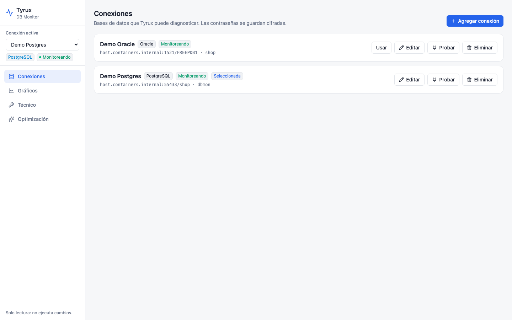
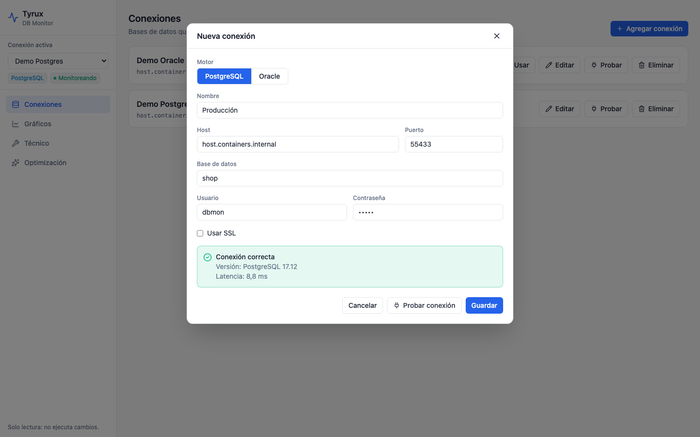

# Conexiones

Las bases que Tyrux puede diagnosticar se configuran desde la propia interfaz, en **Conexiones**.

## Crear una conexión

1. Pulsa **Agregar conexión**.
2. Elige el motor (**PostgreSQL** u **Oracle**). El puerto por defecto cambia solo (5432 / 1521) si no lo habías modificado.
3. Rellena host, puerto, base de datos (en Oracle, el *service name*, por ejemplo `FREEPDB1`), usuario y contraseña. Marca **Usar SSL** si tu servidor lo exige.
4. Pulsa **Probar conexión**: verás la versión del servidor y la latencia, o el mensaje de error del driver.
5. Pulsa **Guardar**. La nueva conexión queda seleccionada.

## Gestionar conexiones

- **Usar**: la convierte en la conexión activa (también desde el selector del menú lateral).
- **Editar**: si dejas la contraseña vacía, se conserva la guardada.
- **Probar**: vuelve a comprobar la conexión guardada.
- **Eliminar**: pide confirmación y borra también su historial de monitoreo.

Las contraseñas se guardan **cifradas** (Fernet) y nunca se devuelven al navegador.

El usuario de conexión necesita permisos de lectura de las vistas de diagnóstico: consulta [[Permisos]].
