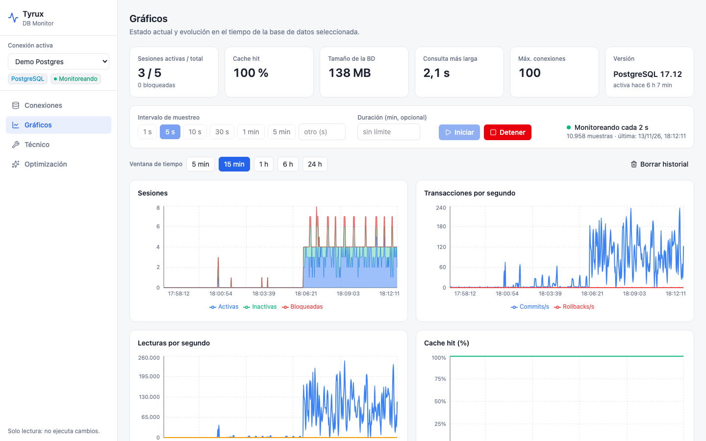
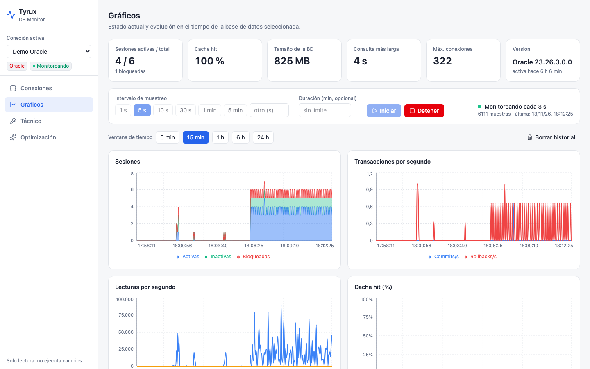
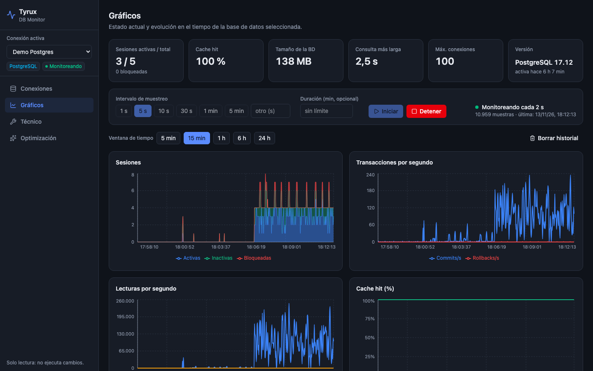

# Gráficos y monitoreo

La sección **Gráficos** muestra el estado actual y la evolución en el tiempo de la conexión activa.

## Indicadores (KPI)

Sesiones activas / total y bloqueadas, cache hit, tamaño de la base, consulta más larga en curso, máximo de conexiones y versión del servidor.

## Monitoreo continuo

1. Elige el **intervalo de muestreo**: presets de 1 s, 5 s, 10 s, 30 s, 1 min y 5 min, u **otro** valor entre 1 y 3600 segundos.
2. Opcionalmente indica una **duración** en minutos; si la dejas vacía, el monitoreo sigue hasta que lo detengas.
3. Pulsa **Iniciar**. El menú lateral muestra «Monitoreando» y el contador de muestras avanza.
4. Pulsa **Detener** cuando quieras.

El muestreo ocurre en el servidor, así que sigue aunque cierres el navegador. El historial se conserva el número de horas indicado en `DBMON_RETENTION_HOURS` (24 por defecto); **Borrar historial** lo vacía.

## Gráficos disponibles

Con la **ventana de tiempo** (5 min, 15 min, 1 h, 6 h, 24 h):

- Sesiones (activas, inactivas, bloqueadas).
- Transacciones por segundo (commits y rollbacks).
- Lecturas lógicas y físicas por segundo.
- Cache hit (%).
- Top consultas del periodo: qué consultas acumularon más tiempo entre las muestras.

Funciona igual con Oracle:

Tema oscuro (sigue la preferencia del sistema):

