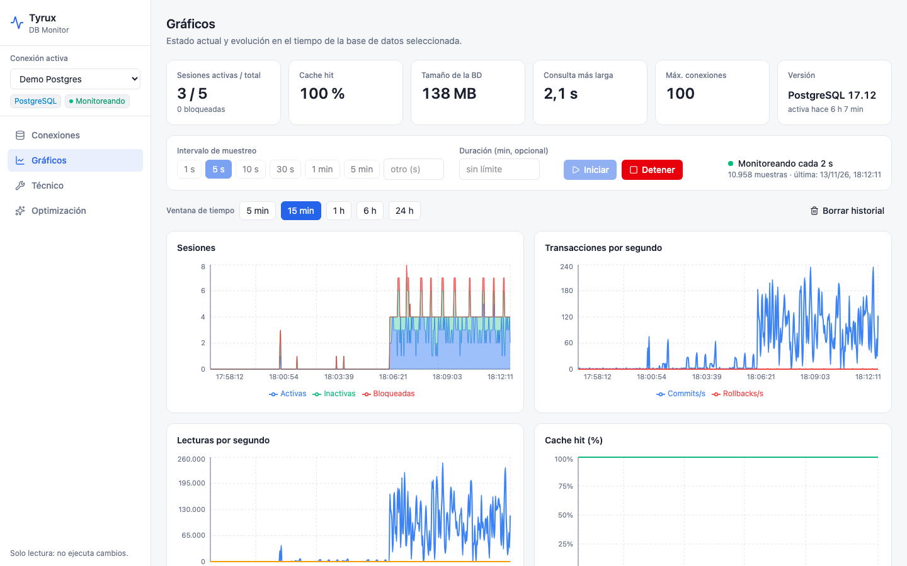

# Tyrux · DB Monitor

**Tyrux** es una herramienta web para diagnosticar y monitorear bases de datos **PostgreSQL** y **Oracle**. Responde a la pregunta «¿por qué está lento mi servicio?»: qué consultas tardan más y por qué, qué índices faltan o sobran, si hay bloqueos, y cómo evoluciona la base en el tiempo.

## Principios

- **Solo lectura.** Tyrux nunca ejecuta DDL ni DML en tu base. Genera el SQL de optimización para que lo revises y lo apliques tú.
- **Sin dependencias pesadas.** Una sola imagen Docker; su propio almacenamiento es SQLite en un volumen.
- **Sin licencias extra en Oracle.** Usa solo vistas `V$`/`DBA_`; no requiere AWR/ASH ni el Diagnostics Pack.

## Contenido

1. [[Instalación]]
2. [[Conexiones]]
3. [[Gráficos y monitoreo]]
4. [[Sección técnica]]
5. [[Optimización]]
6. [[Permisos]]
7. [[Arquitectura]]
8. [[Desarrollo y pruebas]]
9. [[Limitaciones y preguntas frecuentes]]
