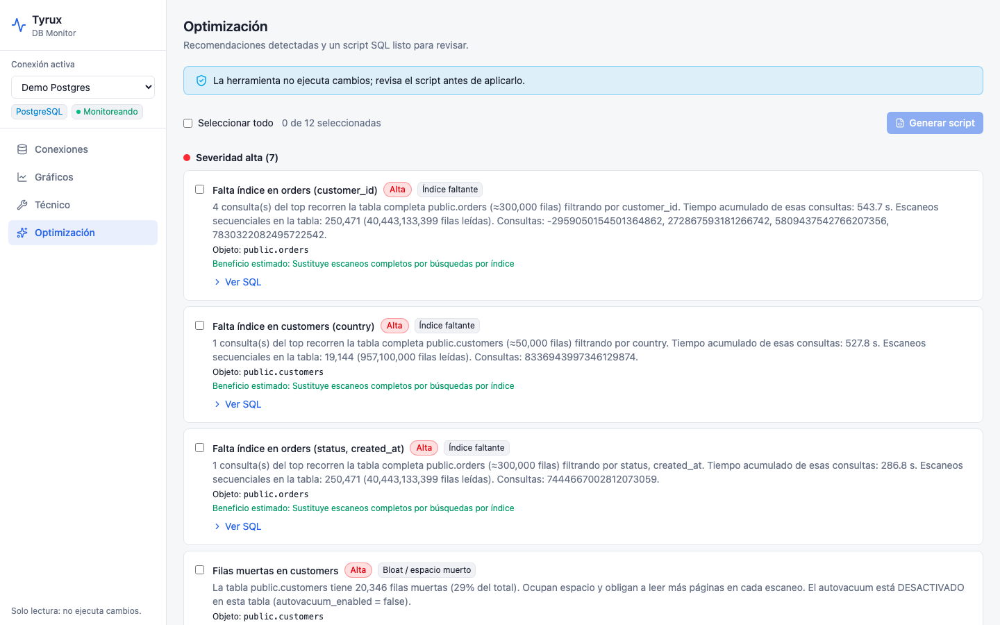
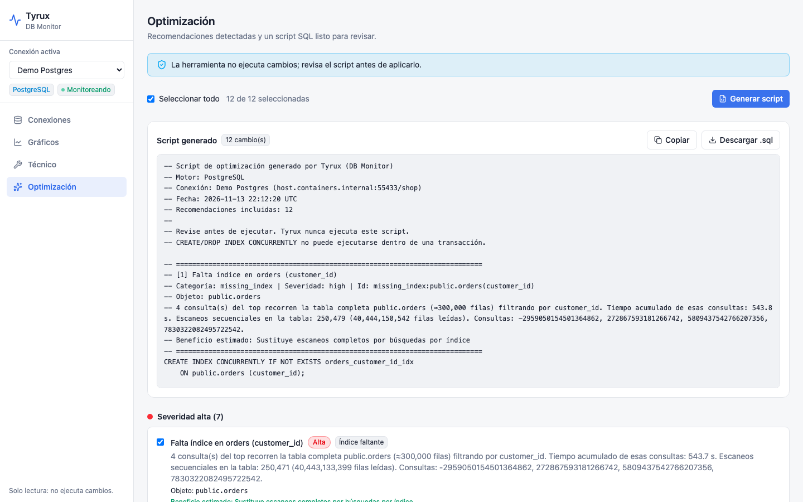

# Optimización

La sección **Optimización** junta todas las recomendaciones para la conexión activa, ordenadas por severidad (alta, media, baja, informativa).

## Recomendaciones

| PostgreSQL | Oracle |
|---|---|
| Falta índice (deducido de consultas lentas y escaneos secuenciales) | Crear índice (deducido del cursor cache) |
| Índice sin uso | Índice sin uso (`DBA_INDEX_USAGE`) |
| Índice duplicado | Índice redundante |
| Estadísticas desactualizadas (`ANALYZE`) | Actualizar estadísticas (`DBMS_STATS`) |
| Filas muertas / bloat (`VACUUM`) | Consulta costosa |
| Muchos escaneos secuenciales | Acierto de buffer cache bajo |
| Cache hit bajo | Uso de procesos o sesiones cerca del límite |
| Sesiones «idle in transaction» | `statistics_level = BASIC` |
| Conexiones cerca del límite | `optimizer_index_cost_adj` modificado |
| Habilitar `pg_stat_statements` / `track_io_timing` | |

## Generar el script

1. Marca las recomendaciones que quieras (o **seleccionar todas**).
2. Pulsa **Generar script**.
3. **Copia** o **descarga** el `.sql`.

El script se genera pensando en producción:

- PostgreSQL: `CREATE INDEX CONCURRENTLY` / `DROP INDEX CONCURRENTLY`, que no bloquean escrituras (no pueden ir dentro de una transacción).
- Oracle: `CREATE INDEX ... ONLINE` y `DBMS_STATS.GATHER_TABLE_STATS`.

> Tyrux **nunca ejecuta** el script. Revísalo, pruébalo en un entorno de pruebas y aplícalo en una ventana adecuada. Las sugerencias de índices son heurísticas: valida con `EXPLAIN` que realmente se usan.
