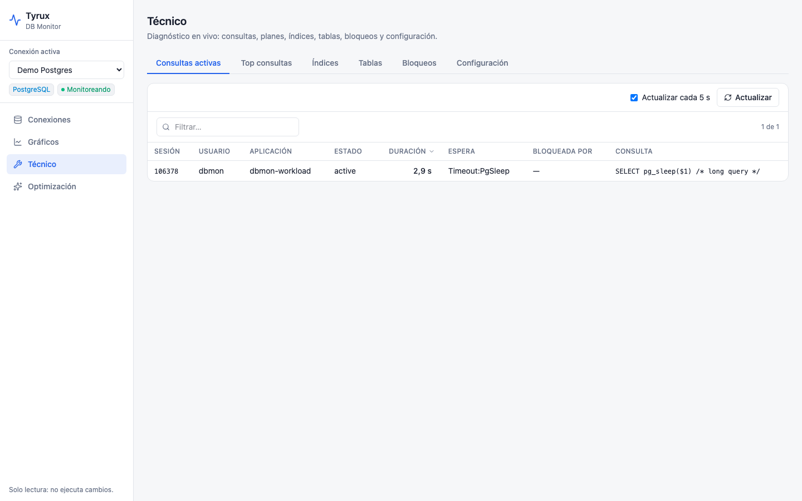
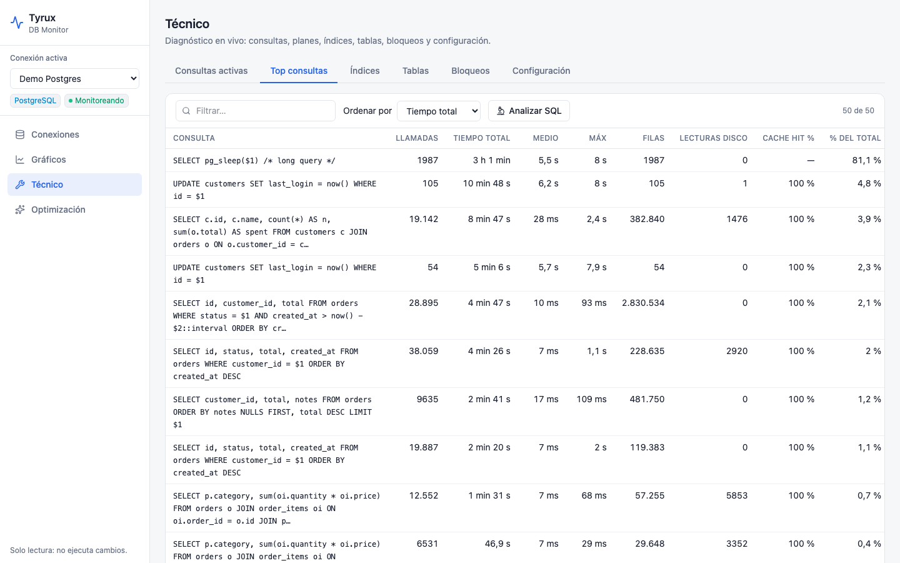
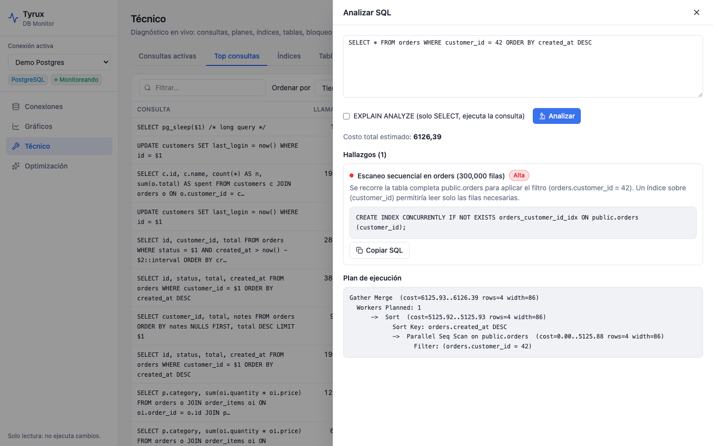
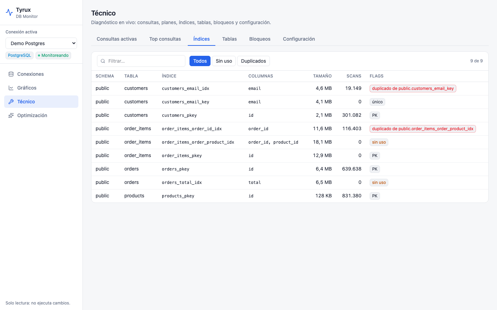
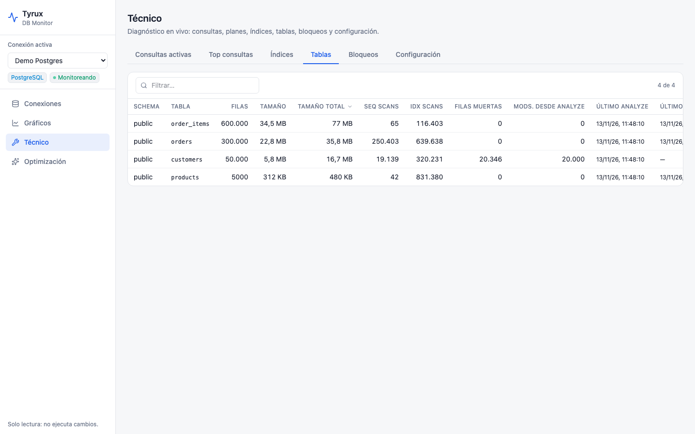

# Sección técnica

La sección **Técnico** reúne el diagnóstico en vivo, organizado en pestañas.

## Consultas activas

Las sesiones que están ejecutando algo ahora: sesión, usuario, aplicación, estado, duración, evento de espera, quién la bloquea y la consulta. Se puede filtrar y refrescar a mano o automáticamente.

## Top consultas

Las consultas con más coste acumulado, ordenables por **tiempo total**, **tiempo medio**, **llamadas** o **I/O**. Cada fila muestra llamadas, tiempos, filas, lecturas de disco, cache hit y el porcentaje del total.

- PostgreSQL: usa `pg_stat_statements` (ver [[Permisos]]).
- Oracle: usa el cursor cache (`V$SQL`).

## Analizar SQL: plan de ejecución y «por qué tarda»

Pulsa una consulta del top, o **Analizar SQL** para pegar la tuya. Tyrux obtiene el plan de ejecución y lo traduce en **hallazgos** con severidad y, cuando aplica, el SQL que lo arregla.

Hallazgos que detecta:

| PostgreSQL | Oracle |
|---|---|
| Escaneo secuencial sobre tablas grandes (con índice sugerido) | `TABLE ACCESS FULL` sobre tablas grandes |
| Escaneo secuencial pese a existir un índice | Producto cartesiano (`MERGE JOIN CARTESIAN`) |
| Ordenación en disco / hash dividido en lotes | Operaciones que usan espacio temporal (TEMP) |
| Estimación de filas muy desviada | Estimación de filas muy desviada |
| Nested Loop con muchas filas externas | `NESTED LOOPS` con muchas filas estimadas |
| Mayoría de lecturas desde disco | Muchas lecturas físicas por ejecución |

**Cómo obtiene el plan:**

- PostgreSQL 16+: `EXPLAIN (GENERIC_PLAN)`, que acepta consultas con parámetros `$1`. En 12–15 usa `PREPARE` con plan genérico forzado.
- Oracle: `DBMS_XPLAN.DISPLAY_CURSOR` si la sentencia está en el cursor cache; si no, `EXPLAIN PLAN`.
- **EXPLAIN ANALYZE** (opcional, solo PostgreSQL): solo se permite con un único `SELECT`, dentro de una transacción de solo lectura que se revierte. Ejecuta de verdad la consulta, úsalo con cuidado en producción.

## Índices

Tamaño, escaneos y estado de cada índice, con marcas de **sin uso** y **duplicado**.

## Tablas

Filas, tamaño (tabla y total), escaneos secuenciales frente a escaneos por índice, filas muertas, modificaciones desde el último análisis y fecha del último `VACUUM`/`ANALYZE` (o de las estadísticas en Oracle).

## Bloqueos

Quién bloquea a quién: sesión bloqueada y sesión bloqueadora con sus consultas, tipo de bloqueo, objeto y tiempo de espera.

## Configuración

Parámetros relevantes del servidor (memoria, paralelismo, estadísticas, conexiones) con su valor actual, el valor recomendado cuando aplica, su categoría y una descripción.
